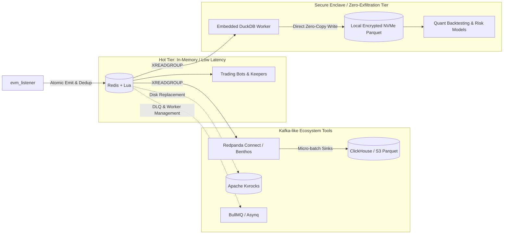

# Redis + Lua Streaming Ecosystem: Scaling Beyond Pure In-Memory Toward Kafka-Grade Architecture

## Context & Architectural Motivation

In the `evm_cpp_listener` architecture, **Redis Streams** (`XADD`, `XREADGROUP`) and **Lua scripts** (executed atomically via [`redis-plus-plus`](file:///Users/jonathan/MyCode/GroAI.fi/evm_cpp_listener/evm_listener/src/sink/redis_sink.hpp)) serve as the real-time event distribution backbone. This provides sub-millisecond dispatch of on-chain logs to downstream arbitrage bots, automated rebalancers, and risk keepers.

However, as systems grow, teams frequently compare Redis Streams to **Apache Kafka** due to Kafka's native support for:
1. **Multi-terabyte disk retention** without filling expensive RAM.
2. **Ecosystem connectors (ETL)** for dumping events directly into analytical databases (e.g., ClickHouse, S3).
3. **Automated consumer orchestration** (dead-letter queues, automatic retries with backoff).
4. **Stream health observability** (out-of-the-box consumer lag tracking).

While Kafka excels at high-throughput disk-backed event logs, introducing Kafka brings operational overhead: JVM runtimes, complex KRaft/ZooKeeper clustering, disk page-cache flush latency ($2 - 10\text{ ms}$ vs. sub-millisecond in-memory), and no native atomic multi-key operations (which Redis Lua provides).

This document details how to combine **Redis + Lua** with specialized open-source companion tooling to achieve Kafka-like durability, stream processing, and consumer management without sacrificing sub-millisecond execution.

---

## Bottom Line Up Front (BLUF)

By pairing Redis + Lua with companion tools, you can match Kafka's primary superpowers:
- **Disk-backed storage**: [Apache Kvrocks](https://kvrocks.apache.org/) (Redis protocol on top of RocksDB / NVMe).
- **Declarative streaming pipelines (Kafka Connect equivalent)**: [Redpanda Connect / Benthos](https://docs.redpanda.com/redpanda-connect/).
- **Zero-exfiltration local analytics (Hedge fund enclave pattern)**: Embedded [DuckDB](https://duckdb.org/) for in-process, on-prem NVMe Parquet archival without network egress.
- **Automated consumer retries & dead-letter queues**: [BullMQ](https://bullmq.io/) or [Asynq](https://github.com/hibiken/asynq).
- **Long-term analytical storage (OLAP)**: [ClickHouse](https://clickhouse.com/), local encrypted Parquet, or private MinIO.



---

## 1. Layer 1: Solve the RAM Limit (Disk-Backed Streams)

### The Kafka Advantage
Kafka persists log segments directly to disk (leveraging the OS page cache). You can store weeks or months of full event history on low-cost NVMe or object storage without exhausting RAM.

### The Problem in Raw Redis
Redis is fundamentally memory-first. If message production outpaces consumption or if you want months of history, you must either:
- Cap the stream using `MAXLEN ~` or `MINID ~` (dropping older messages).
- Pay heavily for multi-terabyte RAM instances.

### The Companion Tool: [Apache Kvrocks](https://kvrocks.apache.org/)
- **What it is**: An open-source, distributed key-value database that implements the **Redis Serialization Protocol (RESP)** and **runs Redis Lua scripts**, but persists data to **RocksDB** on SSD/NVMe.
- **How it integrates with `evm_listener`**:
  - The [`RedisSink`](file:///Users/jonathan/MyCode/GroAI.fi/evm_cpp_listener/evm_listener/src/sink/redis_sink.hpp) connects to Kvrocks exactly like normal Redis.
  - Redis Streams (`XADD`, `XLEN`, `XREADGROUP`) and atomic Lua scripts work transparently.
  - Storage capacity scales with NVMe disk size ($10\times - 100\times$ cheaper per GB than RAM).
- **Latency Trade-off**:
  - Raw Redis: $0.1 - 0.5\text{ ms}$ (pure RAM).
  - Apache Kvrocks: $0.5 - 2.0\text{ ms}$ (RocksDB block cache + SSD).

---

## 2. Layer 2: Kafka Connect Equivalent (Declarative Ingestion & Sinks)

### The Kafka Advantage
Kafka Connect allows teams to stream data from topics into external sinks (Elasticsearch, PostgreSQL, Snowflake, ClickHouse, S3) via declarative configuration files, without writing custom microservices.

### The Companion Tool: [Redpanda Connect](https://docs.redpanda.com/redpanda-connect/) (formerly Benthos)
- **What it is**: A high-performance, single-binary, memory-safe stream processor written in Go.
- **How it works with Redis**:
  - Runs as an independent sidecar process.
  - Consumes from Redis Streams using standard consumer groups (`XREADGROUP`).
  - Performs stateless or windowed transformations, deduplication, and schema reshaping.
  - Automatically batches and writes to downstream analytical stores (ClickHouse, S3, PostgreSQL).

### Production Configuration Example:
Below is a declarative Redpanda Connect pipeline streaming on-chain events from an `evm_listener` Redis Stream into ClickHouse:

```yaml
# redpanda-connect.yaml
input:
  redis_streams:
    url: redis://127.0.0.1:6379
    streams:
      - "evml:8453:events"
    body_key: data
    consumer_group: benthos_clickhouse_archiver
    client_id: worker_01

pipeline:
  processors:
    - mapping: |
        root.chain_id = 8453
        root.block_number = this.block_number.number()
        root.tx_hash = this.tx_hash
        root.log_index = this.log_index.number()
        root.event_signature = this.topics.index(0)
        root.raw_payload = this.string()

output:
  sql_insert:
    driver: clickhouse
    dsn: tcp://clickhouse-node:9000?database=defi_warehouse
    table: base_onchain_logs
    batching:
      count: 1000
      period: 1s
```

---

## 2B. Layer 2 Alternative: Hedge Fund Zero-Exfiltration Archiver (Embedded DuckDB)

### The Hedge Fund Security Constraint: Zero Data Egress
In proprietary trading firms, market makers, and quantitative hedge funds, data security protocols enforce strict perimeter defense:
1. **Zero Third-Party SaaS or Multi-Tenant Cloud Ingestion**: Proprietary trade signals, internal keeper triggers, DEX pool state transitions, and execution timestamps must not transit through public cloud message brokers (e.g., Confluent Cloud, AWS SQS) or multi-tenant database services.
2. **Strict Network Layer Segmentation**: Production trading clusters run in isolated subnets (air-gapped VPCs or colocation bare-metal nodes) where outbound internet egress is strictly blocked to eliminate data leakage.
3. **Minimal Attack Surface**: Running external database daemons with listening network ports (e.g., ClickHouse on port `9000` or Kafka on `9092`) introduces network-level vulnerabilities and lateral movement risk.

### The Companion Tool: Embedded [DuckDB](https://duckdb.org/)
- **What it is**: An in-process, zero-dependency, serverless vectorized SQL OLAP engine written in C++ with native bindings for Python, C++, and Rust (frequently characterized as the "SQLite for columnar analytics").
- **Why it fits the Zero-Exfiltration Mandate**:
  1. **Zero Open Ports / In-Process Execution**: DuckDB runs embedded inside your worker process memory space (`libduckdb`). It does not run a network daemon or expose any listening ports.
  2. **Direct-to-Disk Columnar Parquet**: Consumes events directly from Redis Streams via `XREADGROUP`, buffers them in-memory, and writes compressed columnar `.parquet` files directly onto local LUKS/dm-crypt encrypted NVMe drives (or private on-premise MinIO clusters within the same isolated subnet).
  3. **High-Ratio Columnar Compression**: Uses Zstandard or Snappy compression with dictionary encoding, achieving $10\times - 20\times$ storage compression relative to raw JSON on disk.
  4. **Zero-Copy Analytical Queries**: Quantitative researchers and backtesters can query terabytes of local Parquet files using ANSI SQL with SIMD-vectorized execution, without transferring files across network layers or copying data into a separate database.

### Production Worker Implementation (In-Process DuckDB Archiver)

Below is a production-grade, self-contained Python worker that tails `evm_listener` events from Redis Streams and flushes micro-batches directly to compressed Parquet files on local encrypted storage:

```python
#!/usr/bin/env python3
"""
Zero-Exfiltration In-Process DuckDB Archiver.
Consumes on-chain events from Redis Streams and writes compressed Parquet
directly to a local encrypted NVMe volume within the secure enclave.
"""

import os
import time
import json
import duckdb
import redis

# 1. Configuration loaded strictly from environment / secure local config
REDIS_HOST = os.getenv("REDIS_HOST", "127.0.0.1")
REDIS_PORT = int(os.getenv("REDIS_PORT", "6379"))
STREAM_KEY = os.getenv("STREAM_KEY", "evml:8453:events")
CONSUMER_GROUP = "duckdb_secure_archiver"
CONSUMER_NAME = f"archiver_{os.getpid()}"

# Local encrypted volume mount (LUKS / host-isolated storage)
ARCHIVE_DIR = os.getenv("ARCHIVE_DIR", "/mnt/secure_enclave/onchain_parquet")
BATCH_SIZE = int(os.getenv("ARCHIVE_BATCH_SIZE", "5000"))
FLUSH_INTERVAL_SEC = 30

os.makedirs(ARCHIVE_DIR, exist_ok=True)

# 2. In-process DuckDB instance (zero network ports, runs in-memory)
con = duckdb.connect(database=":memory:")
r = redis.Redis(host=REDIS_HOST, port=REDIS_PORT, decode_responses=True)

# Ensure consumer group exists
try:
    r.xgroup_create(STREAM_KEY, CONSUMER_GROUP, id="0", mkstream=True)
except redis.exceptions.ResponseError as e:
    if "BUSYGROUP" not in str(e):
        raise

def flush_batch_to_parquet(records, msg_ids):
    """Encodes in-memory JSON records into columnar compressed Parquet on local disk."""
    if not records:
        return
    
    timestamp_bucket = int(time.time() // 3600 * 3600)  # Hourly partition
    filename = f"events_chain8453_{timestamp_bucket}_{int(time.time()*1000)}.parquet"
    target_path = os.path.join(ARCHIVE_DIR, filename)

    # DuckDB extracts JSON columns and transposes to columnar Parquet
    con.execute("CREATE OR REPLACE TEMP TABLE batch_raw (payload VARCHAR);")
    con.executemany("INSERT INTO batch_raw VALUES (?);", [[json.dumps(rec)] for rec in records])
    
    # Vectorized export to Zstandard-compressed Parquet on local disk
    con.execute(f"""
        COPY (
            SELECT 
                CAST(json_extract(payload, '$.chain_id') AS BIGINT) AS chain_id,
                CAST(json_extract(payload, '$.block_number') AS BIGINT) AS block_number,
                CAST(json_extract(payload, '$.tx_hash') AS VARCHAR) AS tx_hash,
                CAST(json_extract(payload, '$.log_index') AS BIGINT) AS log_index,
                CAST(json_extract(payload, '$.address') AS VARCHAR) AS address,
                CAST(json_extract(payload, '$.topics[0]') AS VARCHAR) AS topic0,
                CAST(json_extract(payload, '$.timestamp') AS TIMESTAMP) AS block_timestamp,
                payload AS raw_json
            FROM batch_raw
        ) TO '{target_path}' (FORMAT PARQUET, COMPRESSION ZSTD, ROW_GROUP_SIZE 100000);
    """)

    # Acknowledge processed messages in Redis Stream PEL
    r.xack(STREAM_KEY, CONSUMER_GROUP, *msg_ids)
    print(f"[ARCHIVER] Flushed {len(records)} events to {target_path}")

def run_loop():
    buffer_records = []
    buffer_ids = []
    last_flush = time.time()

    while True:
        # Read new stream messages via consumer group
        resp = r.xreadgroup(CONSUMER_GROUP, CONSUMER_NAME, {STREAM_KEY: ">"}, count=1000, block=2000)
        
        if resp:
            for stream_name, messages in resp:
                for msg_id, fields in messages:
                    raw_data = fields.get("data")
                    if raw_data:
                        buffer_records.append(json.loads(raw_data))
                        buffer_ids.append(msg_id)

        now = time.time()
        time_elapsed = now - last_flush

        if len(buffer_records) >= BATCH_SIZE or (buffer_records and time_elapsed >= FLUSH_INTERVAL_SEC):
            flush_batch_to_parquet(buffer_records, buffer_ids)
            buffer_records.clear()
            buffer_ids.clear()
            last_flush = now

if __name__ == "__main__":
    run_loop()
```

### Direct Quant Research Without Network Movement
Because data resides on local NVMe drives in standard Apache Parquet format, quantitative researchers and risk engineers can query the dataset locally with zero network hops:

```python
import duckdb

# Query across months of partitioned Parquet files instantly from the research node
df = duckdb.query("""
    SELECT 
        date_trunc('hour', block_timestamp) AS hour,
        address,
        count(*) AS swap_count
    FROM '/mnt/secure_enclave/onchain_parquet/*.parquet'
    WHERE topic0 = '0xd78ad952c463e811d59473dcf4d7d0e15b6e6105b80701f28f8e00e0ec73b923'
    GROUP BY 1, 2
    ORDER BY hour DESC;
""").to_df()
```

---

## 3. Layer 3: Dead-Letter Queues (DLQ) & Consumer Management

### The Kafka Advantage
Consumer frameworks in the Kafka ecosystem (Kafka Streams, Akka, Spring Kafka) provide out-of-the-box dead-letter topics, exponential backoff retries, and automated partition rebalancing when workers crash.

### The Limitation in Raw Redis Streams
Raw Redis Streams provide primitive primitives:
- Unacknowledged messages sit in the Pending Entries List (PEL).
- Consumers must explicitly query [`XPENDING`](file:///Users/jonathan/MyCode/GroAI.fi/evm_cpp_listener/evm_listener/src/sink/consumer_lag.cpp#L44-L62), check message idle times, and claim orphaned messages using `XCLAIM` or `XAUTOCLAIM`.
- Poison pills (messages causing consumer crashes) loop infinitely unless custom claim counters and dead-letter logic are hand-rolled.

### The Companion Tools: [BullMQ](https://bullmq.io/) (Node.js/TypeScript) & [Asynq](https://github.com/hibiken/asynq) (Go)
If your downstream processing workers are written in TypeScript or Go:
- **BullMQ / Asynq** are production-hardened task and stream queue engines that run directly on top of Redis + Lua.
- **Built-in Capabilities**:
  1. **Dead-Letter Queues (DLQ)**: Automatically moves failed messages to a quarantined stream after $N$ retry attempts.
  2. **Exponential Backoff**: Configurable retry delays ($1\text{s}, 2\text{s}, 4\text{s}, \dots$).
  3. **Concurrency & Rate-Limiting**: Enforces max concurrent workers per consumer instance or partition key.
  4. **Job Dependencies**: Parent-child job orchestration (e.g., rebalance execution triggered only after state validation completes).

---

## 4. Layer 4: Monitoring Consumer Lag & Stream Health

### The Kafka Advantage
Tools like Kafka Lag Exporter, Burrow, and Confluent Control Center provide real-time metrics on how far each consumer group is trailing behind the latest offset.

### The Companion Tools for Redis:

1. **[Prometheus Redis Exporter](https://github.com/oliver006/redis_exporter) + Grafana**:
   - Scrapes Redis stream metadata and exports:
     - `redis_stream_length`: Total entries in the stream.
     - `redis_stream_groups`: Total active consumer groups.
     - `redis_stream_group_pending`: Count of unacknowledged messages in PEL.
     - `redis_stream_group_last_delivered_id`: Last delivered stream ID.

2. **In-Tree Consumer Lag Tracker ([`consumer_lag.hpp`](file:///Users/jonathan/MyCode/GroAI.fi/evm_cpp_listener/evm_listener/src/sink/consumer_lag.hpp))**:
   - The `evm_listener` codebase includes an integrated consumer lag evaluator that queries `XINFO GROUPS` and `XINFO STREAM` to compute:
     $$\text{Consumer Lag} = \text{Stream Last ID} - \text{Group Last Delivered ID}$$
   - Can emit structured metrics or trigger webhooks (e.g., via [`N8N_ALERT_WEBHOOK_URL`](file:///Users/jonathan/MyCode/GroAI.fi/evm_cpp_listener/evm_listener/src/core/config.hpp)) when consumer lag crosses predefined thresholds.

3. **[RedisInsight](https://redis.io/insight/)**:
   - Official Redis graphical workbench for inspecting stream entries, browsing consumer groups, reviewing PEL entries, and profiling Lua script execution times.

---

## Summary: Architecture Comparison

| Capability | Raw Redis + Lua | Redis + Tooling (Standard) | Redis + DuckDB (Hedge Fund Enclave) | Apache Kafka |
| :--- | :--- | :--- | :--- | :--- |
| **Write Latency** | $< 0.5\text{ ms}$ (RAM) | $< 1\text{ ms}$ (RAM) | $< 1\text{ ms}$ (RAM) | $2 - 10\text{ ms}$ (Disk page cache) |
| **Atomic Multi-Key Mutation** | ✅ Native Lua scripts | ✅ Native Lua scripts | ✅ Native Lua scripts | ❌ Storage-only (requires Flink/KStreams) |
| **Massive Historical Storage** | ❌ RAM-capped | ✅ **Apache Kvrocks** or **S3 Tiering** | ✅ **Local Encrypted NVMe Parquet** | ✅ Native tiered disk storage |
| **ETL / Sink Connectors** | ❌ Custom code | ✅ **Redpanda Connect (Benthos)** | ✅ **Embedded DuckDB Worker** | ✅ Kafka Connect ecosystem |
| **Data Perimeter Defense** | ⚠️ Depends on downstream | ⚠️ External network hops (S3 / Cloud DB) | 🔒 **100% In-Process / Zero Egress** | ⚠️ Network broker cluster |
| **Attack Surface / Open Ports** | Single Redis port (`6379`) | Redis + ClickHouse (`9000`) | **Zero extra ports** (in-process library) | Multi-node ports (`9092`, `2181`) |
| **Dead-Letter Queues (DLQ)** | ❌ Manual `XCLAIM` | ✅ **BullMQ / Asynq** | ✅ In-process stream retry / DLQ | ✅ Dead-letter topics |
| **Consumer Lag Monitoring** | ⚠️ Manual `XINFO` | ✅ **Redis Exporter** / [`consumer_lag.cpp`](file:///Users/jonathan/MyCode/GroAI.fi/evm_cpp_listener/evm_listener/src/sink/consumer_lag.cpp) | ✅ [`consumer_lag.cpp`](file:///Users/jonathan/MyCode/GroAI.fi/evm_cpp_listener/evm_listener/src/sink/consumer_lag.cpp) / Prometheus | ✅ Kafka Lag Exporter / Burrow |
| **Operational Overhead** | Minimal (single binary) | Low to Moderate | **Low** (zero external daemons) | High (JVM, ZooKeeper/KRaft cluster) |

---

## Recommended Production Blueprints for EVM Pipelines

### Blueprint A: Cloud & Multi-Tenant Scalable Pipeline (Redpanda Connect + S3 / ClickHouse)
Best for public indexing, multi-cloud clusters, or open analytics platforms where data egress to managed cloud services is permitted:
1. **L1 (Hot Buffer - In-Memory)**:
   - Deploy **Redis + Lua** as the immediate ingestion sink.
   - Use [`RedisSink`](file:///Users/jonathan/MyCode/GroAI.fi/evm_cpp_listener/evm_listener/src/sink/redis_sink.hpp) to perform sub-millisecond block deduplication and emit events via `XADD`.
   - Maintain a sliding window using `MAXLEN ~ 100000` or `MINID` (e.g., retaining 24–48 hours of hot data in RAM).
   - High-frequency arbitrage bots and risk keepers read directly from L1 via `XREADGROUP`.

2. **L2 (Streaming Pipeline - Redpanda Connect)**:
   - Run **Redpanda Connect** as a lightweight sidecar subscribing to the L1 Redis Stream.
   - Batch incoming events every 1–5 seconds or 1,000 events.

3. **L3 (Cold Historical Archive - ClickHouse / S3)**:
   - Redpanda Connect flushes batches to **ClickHouse** or **S3 Parquet** files.
   - Backtesting engines, compliance auditors, and analytics dashboards query L3 without adding read load to the hot L1 Redis instance.

### Blueprint B: Hedge Fund Secure Enclave Blueprint (Zero-Exfiltration via Embedded DuckDB)
Best for proprietary trading firms, risk keepers, and quant research teams where alpha, transaction footprints, and market data cannot leave the private subnet or host machine:
1. **L1 (Hot Buffer - Sub-Millisecond In-Memory Execution)**:
   - Deploy **Redis + Lua** strictly bound to `127.0.0.1` or isolated UNIX domain sockets (`/var/run/redis/redis.sock`).
   - High-frequency execution bots and risk keepers read directly from memory via consumer groups (`XREADGROUP`).

2. **L2 (In-Process Stream Archiver - Zero Network Ports)**:
   - Run the **Embedded DuckDB Archiver** as a local host service or sidecar container without opening any external network ports.
   - Tail the Redis stream with an `XREADGROUP` consumer loop, buffering micro-batches (e.g., 5,000 events or 30 seconds).

3. **L3 (Local Encrypted NVMe Storage - Columnar Parquet)**:
   - DuckDB directly writes Zstandard-compressed Parquet files to a host-local, LUKS/dm-crypt encrypted NVMe volume (or an isolated, internal air-gapped MinIO instance).
   - **Zero Data Egress**: No bytes leave the host boundary or secure VPC layer.
   - **Quant Research Ready**: Quantitative researchers run SIMD-vectorized SQL backtests directly against local Parquet files via Python (`import duckdb`), R, or Julia with instantaneous query execution and zero cloud data egress fees.

---

## Practical Recommendations: Choosing the Right Tool

- **If your goal is historical backtesting, trading analytics, and cold storage**: Use **DuckDB + Parquet**. Neither Kvrocks nor Asynq can do this.
- **If your Redis RAM is filling up from storing too many unconsumed events or stream history**: Swap Redis for **Apache Kvrocks** to store streams on cheap NVMe.
- **If you need reliable background worker execution (retries, timeouts, priority queues)**: Use **Asynq** (in Go) or **BullMQ** (in Node.js).

