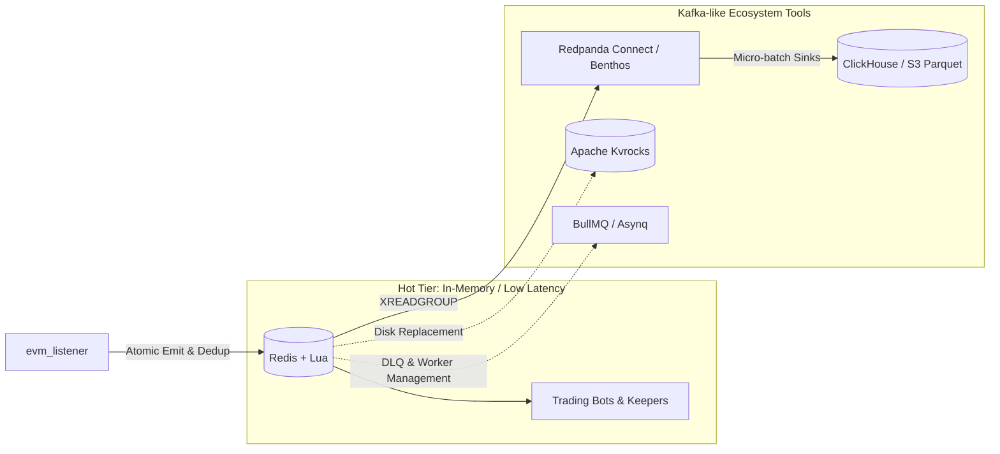

# Redis + Lua Streaming Ecosystem: Scaling Beyond Pure In-Memory Toward Kafka-Grade Architecture

## Context & Architectural Motivation

In the `evm_cpp_listener` architecture, **Redis Streams** (`XADD`, `XREADGROUP`) and **Lua scripts** (executed atomically via [`redis-plus-plus`](file:///Users/jonathan/MyCode/GroAI.fi/evm_cpp_listener/evm_listener/src/sink/redis_sink.hpp)) serve as the real-time event distribution backbone. This provides sub-millisecond dispatch of on-chain logs to downstream arbitrage bots, automated rebalancers, and risk keepers.

However, as systems grow, teams frequently compare Redis Streams to **Apache Kafka** due to Kafka's native support for:
1. **Multi-terabyte disk retention** without filling expensive RAM.
2. **Ecosystem connectors (ETL)** for dumping events directly into analytical databases (e.g., ClickHouse, S3).
3. **Automated consumer orchestration** (dead-letter queues, automatic retries with backoff).
4. **Stream health observability** (out-of-the-box consumer lag tracking).

While Kafka excels at high-throughput disk-backed event logs, introducing Kafka brings operational overhead: JVM runtimes, complex KRaft/ZooKeeper clustering, disk page-cache flush latency ($2 - 10\text{ ms}$ vs. sub-millisecond in-memory), and no native atomic multi-key operations (which Redis Lua provides).

This document details how to combine **Redis + Lua** with specialized open-source companion tooling to achieve Kafka-like durability, stream processing, and consumer management without sacrificing sub-millisecond execution.

---

## Bottom Line Up Front (BLUF)

By pairing Redis + Lua with companion tools, you can match Kafka's primary superpowers:
- **Disk-backed storage**: [Apache Kvrocks](https://kvrocks.apache.org/) (Redis protocol on top of RocksDB / NVMe).
- **Declarative streaming pipelines (Kafka Connect equivalent)**: [Redpanda Connect / Benthos](https://docs.redpanda.com/redpanda-connect/).
- **Automated consumer retries & dead-letter queues**: [BullMQ](https://bullmq.io/) or [Asynq](https://github.com/hibiken/asynq).
- **Long-term analytical storage (OLAP)**: [ClickHouse](https://clickhouse.com/) or Parquet on S3.



---

## 1. Layer 1: Solve the RAM Limit (Disk-Backed Streams)

### The Kafka Advantage
Kafka persists log segments directly to disk (leveraging the OS page cache). You can store weeks or months of full event history on low-cost NVMe or object storage without exhausting RAM.

### The Problem in Raw Redis
Redis is fundamentally memory-first. If message production outpaces consumption or if you want months of history, you must either:
- Cap the stream using `MAXLEN ~` or `MINID ~` (dropping older messages).
- Pay heavily for multi-terabyte RAM instances.

### The Companion Tool: [Apache Kvrocks](https://kvrocks.apache.org/)
- **What it is**: An open-source, distributed key-value database that implements the **Redis Serialization Protocol (RESP)** and **runs Redis Lua scripts**, but persists data to **RocksDB** on SSD/NVMe.
- **How it integrates with `evm_listener`**:
  - The [`RedisSink`](file:///Users/jonathan/MyCode/GroAI.fi/evm_cpp_listener/evm_listener/src/sink/redis_sink.hpp) connects to Kvrocks exactly like normal Redis.
  - Redis Streams (`XADD`, `XLEN`, `XREADGROUP`) and atomic Lua scripts work transparently.
  - Storage capacity scales with NVMe disk size ($10\times - 100\times$ cheaper per GB than RAM).
- **Latency Trade-off**:
  - Raw Redis: $0.1 - 0.5\text{ ms}$ (pure RAM).
  - Apache Kvrocks: $0.5 - 2.0\text{ ms}$ (RocksDB block cache + SSD).

---

## 2. Layer 2: Kafka Connect Equivalent (Declarative Ingestion & Sinks)

### The Kafka Advantage
Kafka Connect allows teams to stream data from topics into external sinks (Elasticsearch, PostgreSQL, Snowflake, ClickHouse, S3) via declarative configuration files, without writing custom microservices.

### The Companion Tool: [Redpanda Connect](https://docs.redpanda.com/redpanda-connect/) (formerly Benthos)
- **What it is**: A high-performance, single-binary, memory-safe stream processor written in Go.
- **How it works with Redis**:
  - Runs as an independent sidecar process.
  - Consumes from Redis Streams using standard consumer groups (`XREADGROUP`).
  - Performs stateless or windowed transformations, deduplication, and schema reshaping.
  - Automatically batches and writes to downstream analytical stores (ClickHouse, S3, PostgreSQL).

### Production Configuration Example:
Below is a declarative Redpanda Connect pipeline streaming on-chain events from an `evm_listener` Redis Stream into ClickHouse:

```yaml
# redpanda-connect.yaml
input:
  redis_streams:
    url: redis://127.0.0.1:6379
    streams:
      - "evml:8453:events"
    body_key: data
    consumer_group: benthos_clickhouse_archiver
    client_id: worker_01

pipeline:
  processors:
    - mapping: |
        root.chain_id = 8453
        root.block_number = this.block_number.number()
        root.tx_hash = this.tx_hash
        root.log_index = this.log_index.number()
        root.event_signature = this.topics.index(0)
        root.raw_payload = this.string()

output:
  sql_insert:
    driver: clickhouse
    dsn: tcp://clickhouse-node:9000?database=defi_warehouse
    table: base_onchain_logs
    batching:
      count: 1000
      period: 1s
```

---

## 3. Layer 3: Dead-Letter Queues (DLQ) & Consumer Management

### The Kafka Advantage
Consumer frameworks in the Kafka ecosystem (Kafka Streams, Akka, Spring Kafka) provide out-of-the-box dead-letter topics, exponential backoff retries, and automated partition rebalancing when workers crash.

### The Limitation in Raw Redis Streams
Raw Redis Streams provide primitive primitives:
- Unacknowledged messages sit in the Pending Entries List (PEL).
- Consumers must explicitly query [`XPENDING`](file:///Users/jonathan/MyCode/GroAI.fi/evm_cpp_listener/evm_listener/src/sink/consumer_lag.cpp#L44-L62), check message idle times, and claim orphaned messages using `XCLAIM` or `XAUTOCLAIM`.
- Poison pills (messages causing consumer crashes) loop infinitely unless custom claim counters and dead-letter logic are hand-rolled.

### The Companion Tools: [BullMQ](https://bullmq.io/) (Node.js/TypeScript) & [Asynq](https://github.com/hibiken/asynq) (Go)
If your downstream processing workers are written in TypeScript or Go:
- **BullMQ / Asynq** are production-hardened task and stream queue engines that run directly on top of Redis + Lua.
- **Built-in Capabilities**:
  1. **Dead-Letter Queues (DLQ)**: Automatically moves failed messages to a quarantined stream after $N$ retry attempts.
  2. **Exponential Backoff**: Configurable retry delays ($1\text{s}, 2\text{s}, 4\text{s}, \dots$).
  3. **Concurrency & Rate-Limiting**: Enforces max concurrent workers per consumer instance or partition key.
  4. **Job Dependencies**: Parent-child job orchestration (e.g., rebalance execution triggered only after state validation completes).

---

## 4. Layer 4: Monitoring Consumer Lag & Stream Health

### The Kafka Advantage
Tools like Kafka Lag Exporter, Burrow, and Confluent Control Center provide real-time metrics on how far each consumer group is trailing behind the latest offset.

### The Companion Tools for Redis:

1. **[Prometheus Redis Exporter](https://github.com/oliver006/redis_exporter) + Grafana**:
   - Scrapes Redis stream metadata and exports:
     - `redis_stream_length`: Total entries in the stream.
     - `redis_stream_groups`: Total active consumer groups.
     - `redis_stream_group_pending`: Count of unacknowledged messages in PEL.
     - `redis_stream_group_last_delivered_id`: Last delivered stream ID.

2. **In-Tree Consumer Lag Tracker ([`consumer_lag.hpp`](file:///Users/jonathan/MyCode/GroAI.fi/evm_cpp_listener/evm_listener/src/sink/consumer_lag.hpp))**:
   - The `evm_listener` codebase includes an integrated consumer lag evaluator that queries `XINFO GROUPS` and `XINFO STREAM` to compute:
     $$\text{Consumer Lag} = \text{Stream Last ID} - \text{Group Last Delivered ID}$$
   - Can emit structured metrics or trigger webhooks (e.g., via [`N8N_ALERT_WEBHOOK_URL`](file:///Users/jonathan/MyCode/GroAI.fi/evm_cpp_listener/evm_listener/src/core/config.hpp)) when consumer lag crosses predefined thresholds.

3. **[RedisInsight](https://redis.io/insight/)**:
   - Official Redis graphical workbench for inspecting stream entries, browsing consumer groups, reviewing PEL entries, and profiling Lua script execution times.

---

## Summary: Architecture Comparison

| Capability | Raw Redis + Lua | Redis + Tooling | Apache Kafka |
| :--- | :--- | :--- | :--- |
| **Write Latency** | $< 0.5\text{ ms}$ (RAM) | $< 1\text{ ms}$ (RAM) | $2 - 10\text{ ms}$ (Disk page cache) |
| **Atomic Multi-Key Mutation** | ✅ Native Lua scripts | ✅ Native Lua scripts | ❌ Storage-only (requires Flink/KStreams) |
| **Massive Historical Storage** | ❌ RAM-capped | ✅ **Apache Kvrocks** or **S3 Tiering** | ✅ Native tiered disk storage |
| **ETL / Sink Connectors** | ❌ Custom code | ✅ **Redpanda Connect (Benthos)** | ✅ Kafka Connect ecosystem |
| **Dead-Letter Queues (DLQ)** | ❌ Manual `XCLAIM` | ✅ **BullMQ / Asynq** | ✅ Dead-letter topics |
| **Consumer Lag Monitoring** | ⚠️ Manual `XINFO` | ✅ **Redis Exporter** / [`consumer_lag.cpp`](file:///Users/jonathan/MyCode/GroAI.fi/evm_cpp_listener/evm_listener/src/sink/consumer_lag.cpp) | ✅ Kafka Lag Exporter / Burrow |
| **Operational Overhead** | Minimal (single binary) | Low to Moderate | High (JVM, ZooKeeper/KRaft cluster) |

---

## Recommended Production Blueprint for EVM Pipelines

For on-chain event listeners and automated trading infrastructure:

1. **L1 (Hot Buffer - In-Memory)**:
   - Deploy **Redis + Lua** as the immediate ingestion sink.
   - Use [`RedisSink`](file:///Users/jonathan/MyCode/GroAI.fi/evm_cpp_listener/evm_listener/src/sink/redis_sink.hpp) to perform sub-millisecond block deduplication and emit events via `XADD`.
   - Maintain a sliding window using `MAXLEN ~ 100000` or `MINID` (e.g., retaining 24–48 hours of hot data in RAM).
   - High-frequency arbitrage bots and risk keepers read directly from L1 via `XREADGROUP`.

2. **L2 (Streaming Pipeline - Redpanda Connect)**:
   - Run **Redpanda Connect** as a lightweight sidecar subscribing to the L1 Redis Stream.
   - Batch incoming events every 1–5 seconds or 1,000 events.

3. **L3 (Cold Historical Archive - ClickHouse / S3)**:
   - Redpanda Connect flushes batches to **ClickHouse** or **S3 Parquet** files.
   - Backtesting engines, compliance auditors, and analytics dashboards query L3 without adding read load to the hot L1 Redis instance.
