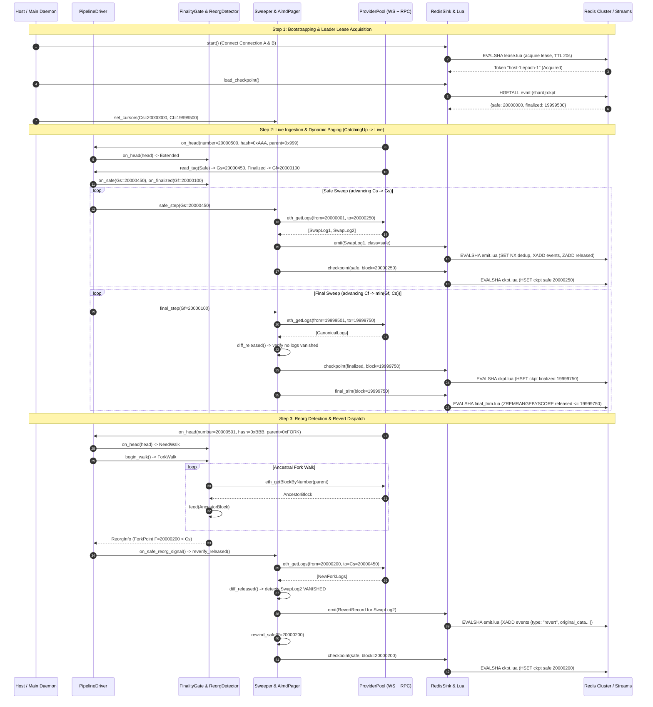
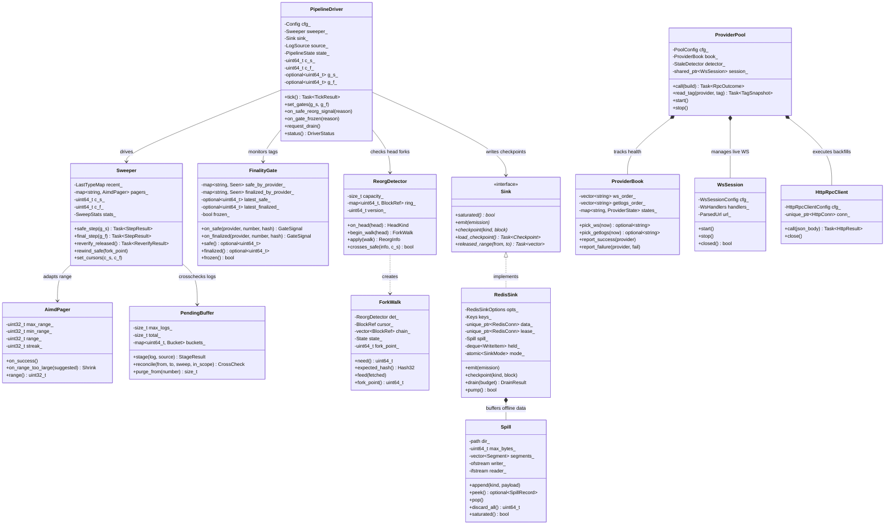

# EVM C++ Listener: Top Modules, Ranking, Architecture & Data Flow

> **Bottom Line Up Front (BLUF)**:  
> The `evm_listener` is a high-throughput, deterministic C++20 daemon engineered to ingest EVM blockchain logs (e.g., Base 8453, Arbitrum, Ethereum L1) and output deduplicated, ordered, reorg-safe events into Redis Streams. It solves four fundamental DeFi infrastructure hazards: **silent event loss**, **unhandled chain reorganizations**, **RPC rate-limit throttling**, and **split-brain multi-instance writes**.
>
> The system is architected around **dual-cursor finality sweeps** ($C_s$ safe, $C_f$ finalized), **Redis Lua atomic deduplication**, **ephemeral CRC32C disk spill buffering**, and **active-passive distributed leader leases**.

---

## 1. Top Modules: Ranking & Comparative Analysis

The system comprises seven specialized modules. Below they are ranked in order of system criticality, algorithmic complexity, and downstream financial safety implications.

| Rank | Module | Core Role | Primary Problem Solved | Catastrophic Failure Implication |
| :---: | :--- | :--- | :--- | :--- |
| **1** | [**`pipeline/`**](../evm_listener/src/pipeline) | **Pipeline & State Orchestration** | Coordinates recovery, catch-up, dual sweeps, AIMD paging, and log reconciliation | **Silent event omission or out-of-order execution** causing trading bots to act on incomplete market data. |
| **2** | [**`chain/`**](../evm_listener/src/chain) | **Consensus & Reorg Safety** | Enforces $G_s / G_f$ finality gates, tracks canonical hash rings, walks ancestry forks, emits reverts | **Downstream bots trading on phantom or reorged blocks**, leading to unhedged losses and corrupted accounting. |
| **3** | [**`sink/`**](../evm_listener/src/sink) | **Storage & Sink Resilience** | Atomic Redis Lua dedup (`SET NX EX`), sliding stream retention (`XADD MINID`), ephemeral CRC32C spill WAL | **Data loss during Redis network partitions**, double-spending on duplicate events, or split-brain dual writers. |
| **4** | [**`provider/`**](../evm_listener/src/provider) | **Provider Supervision & Health** | Manages multi-provider failover chains, health scoring, quota cooldowns, and silent hang detection | **Pipeline paralysis during RPC endpoint outages** or cascading query failures across nodes. |
| **5** | [**`rpc/`**](../evm_listener/src/rpc) | **Transport & Zero-Copy Codec** | Async WebSocket (`Boost.Beast`), HTTP keep-alive, SIMD parsing (`simdjson`), backoff jitter | **Process thread starvation, socket descriptor leaks**, or unhandled RPC rate limits (HTTP 429). |
| **6** | [**`core/`**](../evm_listener/src/core) | **Primitives, Crypto & Config** | Zero-leak `.env` parsing, local Keccak-256 topic0 derivation, TOML schema verification | **Configuration drift, runtime topic mismatch**, or hardcoded credential exposure. |
| **7** | [**`app/`**](../evm_listener/src/app) | **CLI Harness & Verification** | Daemon initialization, binary-search deployment block locator, online contract code validator | **Listener booting on non-deployed contract addresses** or misconfigured chain IDs. |

---

## 2. In-Depth Module Specifications & File References

### Rank 1: [`pipeline/`](../evm_listener/src/pipeline) (Pipeline & State Orchestration)

#### 1. The Problem It Solves
Raw WebSocket feeds from EVM nodes are inherently lossy, unordered during network spikes, and blind to historical gaps. Furthermore, EVM JSON-RPC providers impose rigid block range caps (e.g., Infura 500 blocks, QuickNode 5–10 blocks). `pipeline/` solves this by decoupling live ingestion from release: **`getLogs` is the single source of truth for event release**, while WebSocket messages are staged in a memory buffer strictly for lag cross-checking. It drives two distinct sweeps:
1. **Safe Sweep**: Emits unconfirmed logs between safe cursor $C_s$ and provider safe gate $G_s$, tracking them in Redis `released`.
2. **Final Sweep**: Advances finalized cursor $C_f$ towards $G_f$, diffs against `released`, emits finalized logs, and detects vanished events.

#### 2. Architectural Mechanics
- **State Machine**: Transitions monotonically: `Init` $\rightarrow$ `Recovering` $\rightarrow$ `CatchingUp` $\rightarrow$ `Live` $\rightarrow$ `Draining` / `Failed`.
- **AIMD Dynamic Paging**: Uses Additive Increase / Multiplicative Decrease algorithm to size `eth_getLogs` block spans. On `RangeTooLarge`, it immediately halves the range (or snaps to the provider's suggested limit). On consecutive successes, it doubles the span up to the provider's maximum.
- **Contract Manifest Validation**: Compares the running configuration against `ckpt.contracts` stored in Redis. If a contract is introduced whose start block is below the current checkpoint $C_s$, it halts with exit code 2 to prevent silent historical holes.

#### 3. Failure Implications
If this module has a bug, the listener can skip blocks (breaking the contiguous coverage invariant $I_1$), advance finalized cursors past safe cursors (violating $C_f \le C_s$ invariant $I_2$), or dead-end in an infinite retry loop without alerting operators.

#### 4. Files Involved
* Header: [`pipeline_driver.hpp`](../evm_listener/src/pipeline/pipeline_driver.hpp) | Implementation: [`pipeline_driver.cpp`](../evm_listener/src/pipeline/pipeline_driver.cpp)
* Header: [`sweeper.hpp`](../evm_listener/src/pipeline/sweeper.hpp) | Implementation: [`sweeper.cpp`](../evm_listener/src/pipeline/sweeper.cpp)
* Header: [`pending_buffer.hpp`](../evm_listener/src/pipeline/pending_buffer.hpp) | Implementation: [`pending_buffer.cpp`](../evm_listener/src/pipeline/pending_buffer.cpp)
* Header: [`aimd_pager.hpp`](../evm_listener/src/pipeline/aimd_pager.hpp) | Implementation: [`aimd_pager.cpp`](../evm_listener/src/pipeline/aimd_pager.cpp)
* Header: [`final_diff.hpp`](../evm_listener/src/pipeline/final_diff.hpp) | Implementation: [`final_diff.cpp`](../evm_listener/src/pipeline/final_diff.cpp)
* Header: [`coverage.hpp`](../evm_listener/src/pipeline/coverage.hpp) | Implementation: [`coverage.cpp`](../evm_listener/src/pipeline/coverage.cpp)
* Header: [`log_validation.hpp`](../evm_listener/src/pipeline/log_validation.hpp) | Implementation: [`log_validation.cpp`](../evm_listener/src/pipeline/log_validation.cpp)
* Header: [`event.hpp`](../evm_listener/src/pipeline/event.hpp) | Implementation: [`event.cpp`](../evm_listener/src/pipeline/event.cpp)
* Header: [`sink.hpp`](../evm_listener/src/pipeline/sink.hpp) | Implementation: [`sink.cpp`](../evm_listener/src/pipeline/sink.cpp)
* Header: [`log_source.hpp`](../evm_listener/src/pipeline/log_source.hpp)
* Header: [`last_type_map.hpp`](../evm_listener/src/pipeline/last_type_map.hpp)

---

### Rank 2: [`chain/`](../evm_listener/src/chain) (Consensus & Reorganization Safety)

#### 1. The Problem It Solves
On proof-of-stake EVM networks and L2 rollups (e.g. Base, Arbitrum), block finality is tiered. A block can be:
- **Unsafe / Proposed**: Subject to local reorgs within seconds.
- **Safe**: Committed to L1 data availability, but can still reorg during L1 reorganizations (~26 seconds on Base).
- **Finalized**: Mathematically immutable after 2 epochs (~12.8 minutes on Ethereum L1).

If an ingestion listener emits an event as "safe" and the chain reorgs, downstream trading engines will experience state desynchronization unless an explicit, structured `revert` event is emitted.

#### 2. Architectural Mechanics
- **`FinalityGate`**: Pure state machine tracking the provider's `safe` and `finalized` block heights and hashes. Detects regressions and hash mismatches. If `finalized` ever regresses, it freezes the pipeline permanently (`FinalizedAnomaly`), requiring human inspection.
- **`ReorgDetector` & `ForkWalk`**: Maintains a 512-block ring buffer of `{number, hash, parent_hash}`. When an incoming head's parent does not match the ring's top hash, it triggers a `ForkWalk`. The async engine walks backwards fetching ancestors until it finds the fork point $F$.
- **Revert Emission**: If the fork point $F < C_s$, it triggers `reverify_released()`. Safe-class logs that were released but vanished in the new fork are converted into `revert` events containing the full original event fields, restoring downstream state.

#### 3. Failure Implications
Bypassing or miscalculating reorg depths allows "ghost transactions" to persist in trading bot caches. A liquidation or arbitrage bot might execute real on-chain transactions based on an event that was erased from the canonical ledger.

#### 4. Files Involved
* Header: [`finality_gate.hpp`](../evm_listener/src/chain/finality_gate.hpp) | Implementation: [`finality_gate.cpp`](../evm_listener/src/chain/finality_gate.cpp)
* Header: [`reorg_detector.hpp`](../evm_listener/src/chain/reorg_detector.hpp) | Implementation: [`reorg_detector.cpp`](../evm_listener/src/chain/reorg_detector.cpp)

---

### Rank 3: [`sink/`](../evm_listener/src/sink) (Storage & Sink Resilience)

#### 1. The Problem It Solves
Network partitions to Redis, database restarts, or latency spikes in downstream storage will either crash naive listeners or cause unbounded memory inflation (OOM crashes). Furthermore, in high-availability deployments with active-passive instances, two instances must never write concurrently (split-brain).

#### 2. Architectural Mechanics
- **Embedded Lua Scripting (`kEmitLua`, `kCkptLua`, `kFinalTrimLua`, `kLeaseLua` embedded from `src/sink/lua/*.lua` via `lua_sources.hpp`)**: In one Redis round-trip, `kEmitLua` checks the per-event dedup key (`GET` + compare last type), appends to the stream (`XADD MINID ~ <minid_ms>`), and only then writes the dedup key (`SET ... EX <ttl_s>`). Writing dedup last means a failed script is retried and re-emitted, never silently lost.
- **Dual Connections**: Uses two distinct TCP connections to Redis:
  * Connection A: Carries high-volume write batches (`held_`) and pipeline reads.
  * Connection B: Dedicated exclusively to lease renewal and host heartbeats, ensuring a slow write batch never starves a leader lease renewal.
- **Spill WAL Buffer (`Spill`)**: When Redis is unreachable, the sink enters `Degraded` mode and writes incoming items to rolling 64MB binary segments (`seg-<n>.spill`) on ephemeral disk. Records are protected by CRC32C (Castagnoli) checksums. Upon reconnection (`Replaying`), the spill buffer is drained in strict FIFO order before the live queue resumes.
- **Fenced Leader Lease**: Acquisition requires a distributed lease (`evml:{shard}:leader`, TTL 20s). Every Lua script verifies the caller's unique lease token. If another instance acquires the lease, subsequent writes are rejected with `FENCED`.

#### 3. Failure Implications
A fault in deduplication or spill sequencing causes double processing of swaps, missed position updates, or duplicate mint events, which directly pollutes downstream accounting databases.

#### 4. Files Involved
* Header: [`redis_sink.hpp`](../evm_listener/src/sink/redis_sink.hpp) | Implementation: [`redis_sink.cpp`](../evm_listener/src/sink/redis_sink.cpp)
* Header: [`lua_scripts.hpp`](../evm_listener/src/sink/lua_scripts.hpp) | Implementation: [`lua_scripts.cpp`](../evm_listener/src/sink/lua_scripts.cpp)
* Scripts: [`lua/`](../evm_listener/src/sink/lua) | Generated Header: `lua_sources.hpp`
* Header: [`lease.hpp`](../evm_listener/src/sink/lease.hpp) | Implementation: [`lease.cpp`](../evm_listener/src/sink/lease.cpp)
* Header: [`spill.hpp`](../evm_listener/src/sink/spill.hpp) | Implementation: [`spill.cpp`](../evm_listener/src/sink/spill.cpp)
* Header: [`script_runner.hpp`](../evm_listener/src/sink/script_runner.hpp) | Implementation: [`script_runner.cpp`](../evm_listener/src/sink/script_runner.cpp)
* Header: [`consumer_lag.hpp`](../evm_listener/src/sink/consumer_lag.hpp) | Implementation: [`consumer_lag.cpp`](../evm_listener/src/sink/consumer_lag.cpp)
* Header: [`redis_startup.hpp`](../evm_listener/src/sink/redis_startup.hpp) | Implementation: [`redis_startup.cpp`](../evm_listener/src/sink/redis_startup.cpp)
* Header: [`redispp_conn.hpp`](../evm_listener/src/sink/redispp_conn.hpp) | Implementation: [`redispp_conn.cpp`](../evm_listener/src/sink/redispp_conn.cpp)
* Header: [`redis_conn.hpp`](../evm_listener/src/sink/redis_conn.hpp)
* Header: [`keys.hpp`](../evm_listener/src/sink/keys.hpp)

---

### Rank 4: [`provider/`](../evm_listener/src/provider) (Provider Supervision & Health)

#### 1. The Problem It Solves
Public and commercial EVM RPC nodes (QuickNode, Infura, Alchemy) suffer from intermittent rate limits (HTTP 429), stale block heights (where a node lags the network by 50+ blocks), dropped WebSocket connections, and quota exhaustion. Hardcoding a single RPC endpoint guarantees frequent downtime.

#### 2. Architectural Mechanics
- **`ProviderPool`**: Supervises active WebSocket connections and multiplexes HTTP JSON-RPC calls across failover priority lists (`ws_order` and `getlogs_order`).
- **`ProviderBook`**: Tracks real-time health states: `Up`, `Degraded`, `RateLimited`, `QuotaExhausted`, or `Down`. Enforces a 10-minute stabilization period before failing back to a primary provider.
- **`StaleDetector`**: Detects silent WebSocket stalls and getLogs lag. If a provider's block number remains unchanged while other providers advance, or its safe tag lags behind by more than 30 blocks for over 2 minutes, it trips failover.

#### 3. Failure Implications
Unmanaged provider failure causes log ingestion to freeze silently while the process appears healthy ("zombie process"), masking data staleness from operators.

#### 4. Files Involved
* Header: [`provider_pool.hpp`](../evm_listener/src/provider/provider_pool.hpp) | Implementation: [`provider_pool.cpp`](../evm_listener/src/provider/provider_pool.cpp)
* Header: [`provider_book.hpp`](../evm_listener/src/provider/provider_book.hpp) | Implementation: [`provider_book.cpp`](../evm_listener/src/provider/provider_book.cpp)
* Header: [`stale_detector.hpp`](../evm_listener/src/provider/stale_detector.hpp) | Implementation: [`stale_detector.cpp`](../evm_listener/src/provider/stale_detector.cpp)

---

### Rank 5: [`rpc/`](../evm_listener/src/rpc) (Transport & Zero-Copy Codec)

#### 1. The Problem It Solves
Processing thousands of raw JSON-RPC logs per second with standard DOM-based JSON parsers (e.g. `nlohmann/json`) incurs heavy heap allocation, copying, and CPU overhead. Additionally, half-open TCP sockets can hang forever unless heartbeat/idle timers are strictly enforced.

#### 2. Architectural Mechanics
- **SIMD Parsing (`simdjson::ondemand`)**: `Decoder` allocates a reusable padded string buffer (`simdjson::SIMDJSON_PADDING = 64 bytes`). JSON parsing uses AVX2/NEON vector instructions directly over the raw buffer without intermediate object construction.
- **Asynchronous WebSocket Session (`WsSession`)**: Built on `Boost.Beast` and `Boost.Asio`. Manages SNI TLS handshakes, WebSocket upgrades, RFC 6455 ping/pong keepalives, and idle timeout detection.
- **Persistent HTTP Client (`HttpRpcClient`)**: Maintains keep-alive connections for sequential backfill batches with `Accept-Encoding: identity`.
- **Classification Engine (`classify.hpp`)**: Translates HTTP status codes and JSON-RPC error objects into typed categories: `RateLimited`, `RangeTooLarge`, `Syncing`, `InvalidParams`, or `NetworkError`.

#### 3. Failure Implications
Slow JSON parsing causes memory bloat and delays event release past critical trading latency budgets. Ineffective error classification causes the listener to retry non-retryable errors (e.g., query range too large) indefinitely.

#### 4. Files Involved
* Header: [`ws_session.hpp`](../evm_listener/src/rpc/ws_session.hpp) | Implementation: [`ws_session.cpp`](../evm_listener/src/rpc/ws_session.cpp)
* Header: [`http_rpc_client.hpp`](../evm_listener/src/rpc/http_rpc_client.hpp) | Implementation: [`http_rpc_client.cpp`](../evm_listener/src/rpc/http_rpc_client.cpp)
* Header: [`codec.hpp`](../evm_listener/src/rpc/codec.hpp) | Implementation: [`codec.cpp`](../evm_listener/src/rpc/codec.cpp)
* Header: [`blocking_http.hpp`](../evm_listener/src/rpc/blocking_http.hpp) | Implementation: [`blocking_http.cpp`](../evm_listener/src/rpc/blocking_http.cpp)
* Header: [`backoff.hpp`](../evm_listener/src/rpc/backoff.hpp) | Implementation: [`backoff.cpp`](../evm_listener/src/rpc/backoff.cpp)
* Header: [`classify.hpp`](../evm_listener/src/rpc/classify.hpp) | Implementation: [`classify.cpp`](../evm_listener/src/rpc/classify.cpp)
* Header: [`url.hpp`](../evm_listener/src/rpc/url.hpp) | Implementation: [`url.cpp`](../evm_listener/src/rpc/url.cpp)

---

### Rank 6: [`core/`](../evm_listener/src/core) (Primitives, Crypto & Config)

#### 1. The Problem It Solves
Hardcoded contract topic hashes or manual ABI encoding frequently introduce silent typos. Furthermore, committing API keys or hardcoding secrets in configuration files creates severe security vulnerabilities.

#### 2. Architectural Mechanics
- **Local Keccak-256 (`keccak.hpp`)**: Directly invokes `ethash::keccak256` to compute `topic0` hashes locally at boot time from canonical event signatures (e.g. `Swap(...)`), preventing human hex errors.
- **Dynamic `.env` Loading & Redaction (`env.hpp`)**: Resolves configuration variables by walking up parent directories, substituting `${VAR}` tokens, and redacting secret keys in logs and URLs.
- **Strict TOML Parser (`config.hpp`)**: Uses `toml++` to parse shard configurations and build validated dispatch tables mapping `(contract_address, topic0)` to destination streams and finality tiers.

#### 3. Failure Implications
An unverified event signature or wrong topic hash means the listener silently discards all incoming swap or transfer events, blinding downstream systems.

#### 4. Files Involved
* Header: [`config.hpp`](../evm_listener/src/core/config.hpp) | Implementation: [`config.cpp`](../evm_listener/src/core/config.cpp)
* Header: [`env.hpp`](../evm_listener/src/core/env.hpp) | Implementation: [`env.cpp`](../evm_listener/src/core/env.cpp)
* Header: [`keccak.hpp`](../evm_listener/src/core/keccak.hpp) | Implementation: [`keccak.cpp`](../evm_listener/src/core/keccak.cpp)
* Header: [`hex.hpp`](../evm_listener/src/core/hex.hpp) | Implementation: [`hex.cpp`](../evm_listener/src/core/hex.cpp)
* Header: [`log.hpp`](../evm_listener/src/core/log.hpp) | Implementation: [`log.cpp`](../evm_listener/src/core/log.cpp)
* Header: [`error.hpp`](../evm_listener/src/core/error.hpp)
* Header: [`version.hpp.in`](../evm_listener/src/core/version.hpp.in) | Implementation: [`version.cpp`](../evm_listener/src/core/version.cpp)

---

### Rank 7: [`app/`](../evm_listener/src/app) (Application Sharding & Operational Tooling)

#### 1. The Problem It Solves
Deploying listeners into production requires pre-flight sanity checks to ensure RPC endpoints match the target chain ID and contracts actually exist on-chain before long backfills begin.

#### 2. Architectural Mechanics
- **`find_deploy_block`**: Employs an exact binary search over `eth_getCode` to locate the precise block number where a contract was deployed, eliminating manual block lookups.
- **`check_config_online`**: Pre-flight verification that verifies `eth_chainId` across all providers and ensures bytecodes exist at `latest`.
- **`probe_transport`**: Live end-to-end dry run validating that WebSocket heads stream and `getLogs` queries succeed before full pipeline initialization.

#### 3. Failure Implications
Starting a listener with a misconfigured start block forces massive redundant RPC backfills (e.g. searching 10M blocks on Base) or crashes upon attempting to parse logs from non-existent contracts.

#### 4. Files Involved
* Header: [`pool_config.hpp`](../evm_listener/src/app/pool_config.hpp) | Implementation: [`pool_config.cpp`](../evm_listener/src/app/pool_config.cpp)
* Header: [`tools.hpp`](../evm_listener/src/app/tools.hpp) | Implementation: [`tools.cpp`](../evm_listener/src/app/tools.cpp)
* Implementation: [`main.cpp`](../evm_listener/src/main.cpp)

---

## 3. End-to-End Sequence Diagram: Core Lifecycle & Reorg Handling

The following diagram illustrates the primary operational lifecycle: **bootstrapping $\rightarrow$ backfill sweep $\rightarrow$ live streaming $\rightarrow$ reorg detection $\rightarrow$ revert emission**.

---

## 4. Architectural Class Diagram

The following diagram details the structural relationships between the principal classes of the system.

---

## 5. System Invariants Matrix

Every module is designed to uphold the following mathematical invariants:

| Invariant | Mathematical Expression | Enforcing Module | Plain-Language Guarantee |
| :--- | :--- | :--- | :--- |
| **$I_1$ (Coverage)** | $\forall b \in [start, C_s]$, $b$ is swept | `pipeline/sweeper` | **No skipped blocks**: Every single block between start and checkpoint is swept without gaps. |
| **$I_2$ (Dual Finality)** | $C_f \le C_s$ and $G_f \le G_s$ | `chain/finality_gate` | **Finality ordering**: Finalized blocks can never pass safe unconfirmed blocks. |
| **$I_3$ (Monotonic Ckpt)** | $C_t \le C_{t+1}$ (persisted) | `sink/lua_scripts` (`kCkptLua`) | **Monotonic checkpoints**: The stored checkpoint only moves forward (`advance` returns `NOOP` if not higher). A reorg rewinds only the sweeper's in-memory cursor (`Sweeper::rewind_safe`). |
| **$I_4$ (Deduplication)** | At most 1 emit per (event_id, type) within dedup TTL, barring script failure | `sink/lua_scripts` (`kEmitLua`) | **Duplicates suppressed, never lost**: Retries and restarts return `DUP`; if a script fails midway, the retry may re-emit (allowed duplicate) rather than drop the log. |
| **$I_5$ (Never Skip)** | Failure $\implies$ retry or halt | `pipeline/pipeline_driver` | **Fail-stop on ambiguity**: On unresolvable provider disagreement, halt and alert instead of guessing. |
| **$I_6$ (Revert Fidelity)**| Revert has original fields | `pipeline/final_diff` | **Exact rollback**: Reverts emit identical before-images so downstream state machines can rewind cleanly. |
