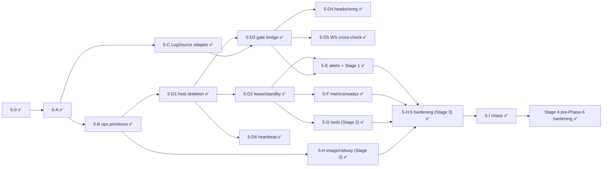

# Phase 5 readiness review + worker task list

Reviewed [60_phase5_ops.md](60_phase5_ops.md) (rev 7) against the code at `d91de9e` (`feat/lua-seperation`).

**Verdict: ready to start, with conditions.** First confirm the decisions in §2. The plan describes the ops features (alerts, watchdog, `/readyz`). It never specifies the **host process that runs the listener**, and that process does not exist yet. That host is the largest piece of Phase 5.

---

## 1. Findings

### 1.1 Blocking gaps: the plan does not specify these, and the code does not have them

| # | Gap | Evidence | Consequence if not specified |
|---|---|---|---|
| G1 | **No daemon / host assembly.** `main.cpp` only dispatches the CLI tools. Nothing builds pool + gate + driver + sink, and nothing runs the tick loop. Plan 60 has no section for it. | [main.cpp](file:///Users/jonathan/MyCode/GroAI.fi/evm_cpp_listener/evm_listener/src/main.cpp), [tools.cpp `run_cli`](file:///Users/jonathan/MyCode/GroAI.fi/evm_cpp_listener/evm_listener/src/app/tools.cpp) requires exactly one of `--check-config` / `--find-deploy-block` / `--probe-transport`. The Railway `startCommand` (`--config … ` with no action) currently exits 2. Plan 50 deviation 5: "`main.cpp` is still a stub". | Each worker guesses its own thread model and startup order. |
| G2 | **Nothing feeds the gates.** Nothing turns pool tag polls into `FinalityGate` and then into `driver.set_gates`. `PoolHandlers` has no tag callback. | `FinalityGate` / `ReorgDetector` are referenced only in `chain/` and one comment ([grep](file:///Users/jonathan/MyCode/GroAI.fi/evm_cpp_listener/evm_listener/src/pipeline/pipeline_driver.hpp#L60)). [PoolHandlers](file:///Users/jonathan/MyCode/GroAI.fi/evm_cpp_listener/evm_listener/src/provider/provider_pool.hpp) has only head / log / transition / ws callbacks. | The driver never leaves Recovering (`g_s_` stays nullopt). |
| G3 | **The WS cross-check is not wired.** `PendingBuffer` (plan 40 §3.4) is used only by its unit test. `ws_extra_logs_total` and the **WS Missed Logs** alert have no data source. | `grep PendingBuffer src/` matches only `pending_buffer.*`. | One alert in §5.3.3 cannot fire. |
| G4 | **`ProviderPool` lacks the API that §5.4a needs:** a call to a named provider with an exclude set, `report_bad` → `on_failure(Retry)`, and a per-provider token bucket. | `call_on(provider, …)` is **private** ([provider_pool.hpp:190](file:///Users/jonathan/MyCode/GroAI.fi/evm_cpp_listener/evm_listener/src/provider/provider_pool.hpp#L190)). Public `call()` walks the whole chain. `ProviderBook::pick_getlogs(now, exclude)` exists. | The adapter cannot meet "page retries exclude the failed provider" or "`block(n)` never asks the logs provider". |
| G5 | **No async generic HTTP client** for the n8n POST (custom header) and the healthchecks GET. `HttpRpcClient` is JSON-RPC only, and `blocking_http` is blocking, so it is forbidden on the io thread. | [http_rpc_client.hpp](file:///Users/jonathan/MyCode/GroAI.fi/evm_cpp_listener/evm_listener/src/rpc/http_rpc_client.hpp) has only `call(json_body)`. | Alert and dead-man transport have nothing to run on. |

### 1.2 Plan mistakes or risks (proposed fixes are in §2)

| # | Issue | Why it matters |
|---|---|---|
| R1 | **The watchdog gives a false positive after `docker pause` or a VM suspend.** §5.1 aborts when a heartbeat is older than 30 s. After a 30 s+ pause, the watchdog thread can wake before the io thread ticks, see a stale heartbeat, and abort. This contradicts the §Tests expectation "after unpause, a demotes itself on its next renew". | The test will be flaky, and it causes a spurious restart on host hiccups. |
| R2 | **"`kill -STOP` of the io thread only" is impossible on Linux.** SIGSTOP stops the whole process. | That test cannot be written as specified. |
| R3 | **§5.1 says "3 consecutive deadlines → … demote".** If the cause is shared (for example a provider outage), the leader demotes, the standby takes over and stalls too, and the two ping-pong. Phase 3 only says "report_bad + PipelineStalled". | Leader flapping, with no data benefit. |
| R4 | **`PORT` vs `[ops].http_listen` precedence is undefined.** §5.2 says `[::]:${PORT:-9464}`, but `base.toml` hardcodes `http_listen = "[::]:9464"`. Railway's healthcheck uses `PORT`. | The deploy healthcheck can probe the wrong port. |
| R5 | **The `/readyz` "gate age OK" condition is undefined.** | Every implementer will pick a different rule. |
| R6 | **Who fires each alert across 2 hosts is undefined.** If the standby evaluates pipeline alerts it duplicates or sends false alerts. "Leader Changed": old or new host? | Duplicate Slack pages. |
| R7 | **`--backfill-contract` writes through fenced scripts**, but §5.6a never says it must acquire the lease. With `[lease] enabled = true`, unfenced writes are refused. | The tool cannot write. |
| R8 | **New config keys have no section:** `pending_max_logs`, `reconcile_rps`, `reconcile_burst`. The loader rejects unknown keys ([config.cpp:45](file:///Users/jonathan/MyCode/GroAI.fi/evm_cpp_listener/evm_listener/src/core/config.cpp#L45)). | Each worker picks a different section. |
| R9 | **Paths differ from the repo.** The plan says `evm_listener/deploy/docker/Dockerfile`, `deploy/docker/docker-compose.dev.yml` and `deploy/railway/railway.json`. The repo has [docker/Dockerfile.prod](file:///Users/jonathan/MyCode/GroAI.fi/evm_cpp_listener/docker/Dockerfile.prod), [mk/60-prod.mk](file:///Users/jonathan/MyCode/GroAI.fi/evm_cpp_listener/mk/60-prod.mk) and `.devcontainer/docker-compose.yml` (redis + toxiproxy). | Duplicate Dockerfiles. |
| R10 | **`Dockerfile.prod` gaps vs §5.7:** no `tini`, no `STOPSIGNAL`, no `HEALTHCHECK`, no config copied to `/app/config/base.toml`. It still passes `-DEVML_BUILD_COMMON=OFF`, an option you just removed from `CMakeLists.txt`, so CMake warns "unused variable". The comment says ~80 MB; the target is < 60 MB. | The Railway `startCommand` points at a file that is not in the image. |

### 1.3 Already in place (do not rebuild)
- `[ops]` / `[watchdog]` config is parsed. The webhook-without-token case and non-https URLs are rejected. An empty dead-man URL gives a WARN note ([config.cpp:570-596](file:///Users/jonathan/MyCode/GroAI.fi/evm_cpp_listener/evm_listener/src/core/config.cpp#L570-L596)).
- `host_id` resolves TOML → `$EVML_HOST_ID` → hostname.
- JSON stdout logging (`core/log`) and `core::env::redact()` exist.
- Uncovered-contract startup check: the driver fails and names `--backfill-contract` ([pipeline_driver.cpp:102-106](file:///Users/jonathan/MyCode/GroAI.fi/evm_cpp_listener/evm_listener/src/pipeline/pipeline_driver.cpp#L102-L106)).
- Sink side:
  - `status()` exposes the counters for alerts;
  - `consumer_lag()` returns snapshots that include `probed_at_ms`;
  - `loop_heartbeat_ms()` is there for the watchdog;
  - `set_heartbeat()`, `drain()`, and the lease functions are in place.
- `DriverStatus` has every field the pipeline alerts need.
- `prometheus-cpp` (core, `with_pull=False`) is already a Conan dependency.
- `.env.example` documents the N8N, DEADMAN, `EVML_HOST_ID` and `REDIS_URL` variables.

### 1.4 Rev 9 review fixes (2026-10-22)
- `railway.json` `startCommand` removed: Railway runs it in place of the image `ENTRYPOINT`, which would bypass `tini`.
- "No quorum → `Stalled`" replaced by nullopt → `Retry` + progress deadline (no `LogSource` change).
- Added: lease-disabled branch, per-leadership rebuild list, watchdog sink-beat only while leader, watchdog threshold from config, Leader Changed source.
- Ping job file renamed `71_job_ws_ping_liveness.md` (70 is the Phase 6 plan).

### 1.5 Housekeeping
- The master plan §5 status is stale: it says Phase 4 is "Uncommitted", but the commits exist. Update it in 5-0.

---

## 2. Decisions needed (the recommended default is listed first; the worker uses it unless you say otherwise)

| # | Decision | Recommended |
|---|---|---|
| D1 | Add a **§5.H Host process** section to plan 60 (design in slice 5-D below) | **Yes.** I write it into plan 60 before the worker starts. |
| D2 | Watchdog pause tolerance (R1) | The watchdog tracks its own wake gap. If its own sleep overran by more than 5 s, it resets the baselines and skips that check. It aborts only on a heartbeat that has been stale for 30 s **while the watchdog itself ran on time**. |
| D3 | io-freeze test (R2) | Unit-test `Watchdog` with injected clocks and an injected abort callback. Add a test-only build flag `EVML_TEST_HOOKS` with `--test-freeze-io-after <s>`, which posts a blocking sleep onto the io thread, for one integration test expecting exit 134. |
| D4 | Stall → demote (R3) | **No demotion in v1.** `PipelineStalled` alert + `report_bad` only. |
| D5 | `PORT` precedence (R4) | If `$PORT` is set, it overrides the port in `http_listen`, and the host is kept. |
| D6 | `/readyz` gate age (R5) | `G_s` advanced within `watchdog.safe_gate_stuck_s`. |
| D7 | Alert ownership (R6) | Pipeline, provider, sink and consumer alerts: **leader only**. Host-local alerts (Redis Unreachable, Redis Misconfigured, Sink Fenced): either host. Leader Changed: fired by the **new** leader on acquire, when the previous lease token's host ≠ self. |
| D8 | Backfill + lease (R7) | `--backfill-contract` acquires the lease (blocking, 60 s max). It exits 1 if another host holds it, then runs fenced and releases at the end. |
| D9 | Config placement (R8) | `[chain] pending_max_logs` and `[redundancy] reconcile_rps` / `reconcile_burst`. Add a new `[ws]` section only in slice 5-J. |
| D10 | Paths (R9) | Keep `docker/Dockerfile.prod`, `.devcontainer/docker-compose.yml` (add `listener-a` / `-b` under a compose profile), and put `railway.json` at the **repo root**, Railway's default location. Update plan 60 text. |
| D11 | Rev 7 `ping` mode (§5.1a) | **Superseded:** a separate job after Phase 6, see [71_job_ws_ping_liveness.md](71_job_ws_ping_liveness.md). Not part of Phase 5. |

---

## 3. Task list for the worker agent (rev 2, 2026-10-27: replaces the rev 1 list; status as of this date)

Rules for every slice:
- **Gate:** `make build` and `make test` exit 0. The tree is ASan/UBSan `-Werror`. Run make with `PATH=/usr/local/bin:$PATH` and the dev container up (`docker compose -f .devcontainer/docker-compose.yml up -d dev`).
- Update plan 60 "results and deviations" before ticking a slice.
- No commits without the user's instruction. Surgical diffs.
- Secrets come from the env only, and `redact()` is applied before any log line.

Status: ✅ done · 🟡 partial · ⬜ not started.

### ✅ 5-0 Prep · ✅ 5-A Config
See plan 60 "results and deviations".

### ✅ 5-B Ops primitives (pure / unit-testable, no host yet)
- [x] **B1 `src/ops/watchdog.{hpp,cpp}`** (rework done 2026-10-27, review decisions Q1–Q3 accepted):
  - one thread, two heartbeats (io tick, sink loop), 1 s check, threshold passed in by the caller (no default, 0 throws);
  - D2 pause tolerance; abort line on **stdout** in the `core/log` schema (`ts`, `level`, `message`, `component`) with the last known state (`role`, `driver_state`, `c_s`, `c_f`, `g_s`, `g_f`, `sink_mode`, published by the io thread through `publish_state`);
  - `stale_heartbeat()` for `/healthz`;
  - the sink stores its beat through `RedisSinkOptions::loop_beat`, which points at storage owned by the watchdog (`sink_beat_slot()`); unregister the sink (`set_sink_registered(false)`) **before** destroying it;
  - `std::abort()` → exit 134.
  - Open points: A7 (134 needs `tini` as PID 1; verified in 5-I inside the prod image); the host must pass `[watchdog].process_stall_ms` (5-D1).
- [x] **B2 `src/ops/http_client.{hpp,cpp}`:** async Beast HTTPS client on the io executor: `post_json(url, body, headers)` and `get(url)`. Timeout, TLS verification (same SSL context approach as `HttpRpcClient`), URL redacted in every error.
  - Tests against `tests/mock_http_server`: header sent, timeout, non-2xx, URL absent from errors.
- [x] **B3 `src/ops/ops_http_server.{hpp,cpp}`:** Beast server on the io thread with `/healthz`, `/readyz`, `/metrics` through callbacks returning status + body; unknown path → 404; bind `[::]` with `v6_only(false)`.
  - Tests: each endpoint, 404, and dual-stack (`http://127.0.0.1:<port>/healthz` and `http://[::1]:<port>/healthz` both 200).
- [x] **B4 `src/ops/metrics.{hpp,cpp}`:** prometheus-cpp registry + `TextSerializer`; helper that sets a counter from a monotonic total (delta increment).
  - Tests: serialized output contains the names; repeated totals do not double-count.

### ✅ 5-C `LogSource` adapter (§5.4a), parallel with 5-B
- [x] **C1 `ProviderPool` public API** (audit every call site; `call_on` is private today):
  - `call_to(provider, RequestBuilder)`, `pick_getlogs_excluding(set)`, `report_bad(provider, reason)` → book `on_failure(Retry)` + an inconsistency counter, and a per-provider token bucket (`reconcile_rps` / `burst`) that every `call_to` respects.
- [x] **C2 `src/app/pool_log_source.{hpp,cpp}`** implementing `pipeline::LogSource`:
  - `get_logs` retries the next provider, excluding the ones already tried;
  - `block(n)` reads the `ReorgDetector` ring first; on a miss it asks a provider ≠ the logs provider;
  - disagreement → `report_bad` + nullopt; no quorum → nullopt (= `Retry`);
  - **no block-info cache** (Q4: the sweeper already reads each distinct block once per page);
  - do **not** change the `LogSource` interface or the sweeper (rev 9).
- [x] **C3 Tests** against MockProvider / `mock_http_server`, one per bullet of the §Tests "LogSource adapter" item, plus "one `block(n)` call per distinct block per page".

### ✅ 5-D Host process (§5.H), split into six sub-slices; each has its own gate
- [x] **D1 Skeleton (single host, `[lease] enabled = false`):** done 2026-10-27, see plan 60 "5-D1" (gate bridge pulled in; startup thread for the Redis wait; dedicated io-beat timer)
  - CLI: no action flag + `--config` runs the listener; keep the tool flags;
  - threads io + sink + watchdog; startup order 1–4 and 6; the watchdog gets `[watchdog].process_stall_ms`; io beat + `publish_state` every tick; the sink gets `loop_beat = watchdog.sink_beat_slot()`;
  - SIGTERM/SIGINT → `request_drain()` → `sink.drain(25 s)` → exit 0; exit codes 2 / 1 / 134;
  - test-only build flag `EVML_TEST_HOOKS` + `--test-freeze-io-after <s>` (D3).
  - **Accept:** cold start reaches Live against Docker Redis + MockProvider; SIGTERM exits 0; the freeze hook exits 134.
- [x] **D2 Lease:** acquire or the standby loop (every `renew_ms`); per-leadership rebuild (§5.H); demotion on `Fenced`; register / unregister the sink beat around each term. **Deferred to 5-E:** read the `epoch` key before acquire for Leader Changed (D7); no consumer yet (see plan 60, 5-D2 deviations).
  - **Accept:** two hosts; kill the leader → the standby leads within 20 s; the stream has no gap.
- [x] **D3 Gate bridge (G2), re-scoped:** the bridge itself (`on_tag`, `FinalityGate` → `set_gates`, reorg / frozen signals) was delivered in D1. D3 added host-level tests for `SafeRegression` → reverify, `FinalizedAnomaly` → frozen driver, and a failover where the new getLogs provider reports lower tags (plan 60, 5-D3).
  - **Accept:** the driver leaves Recovering on real tag polls.
- [x] **D4 Heads → `ReorgDetector`:** fork walk via `call_to` on the WS provider; a crossing below `C_s` → `on_safe_reorg_signal`. Also fills `BlockRef::timestamp` and passes the ring to `PoolLogSource`. Walk capped at 16 blocks; longer gaps or deeper forks resync the ring and re-verify (plan 60, 5-D4).
- [x] **D5 WS cross-check (G3):** read plan 40 §3.4 first; logs → `PendingBuffer(pending_max_logs)`; compare with sweep results for `ws_extra_logs_total` / WS Missed Logs. If the sweeper does not expose its released set per page, **stop and report before changing it**.
- [x] **D6 Heartbeat payload:** every `heartbeat_s` → `sink.set_heartbeat`; wire `host_id` / `heartbeat_ms` into `RedisSinkOptions` (plan 50 4e dev. 2).

### ✅ 5-E Alert engine + transport + dead-man (§5.3)
- [x] **E1 `src/ops/alerts`:** pure rule evaluation over `OpsSnapshot`; condition alerts fire / 15 min re-notify / resolve, event alerts fire once per occurrence with no resolve; per-group and per-provider 15 min rate limits; D7 ownership; a consumer-lag snapshot older than 2× the probe interval is unknown.
- [x] **E2 `src/ops/alert_sender`:** exact JSON schema and `X-API-Key`; 3 retries with jittered backoff, then ERROR + `evml_alert_send_failures_total`; token and URL never in logs.
- [x] **E3 `src/ops/deadman`:** pings only when leader and healthy (§5.3.2); 10 s timeout; failures counted; empty URL → `"deadman":"disabled"` in `/readyz`.
- [x] **E4a Host wiring (split from E4, 2026-10-28):** `ops/snapshot` builds the `OpsSnapshot` from live host state every 10 s; the host feeds the engine, the sender and the dead-man; counter-delta events (Safe Reorg, Sink Invariant, WS Missed Logs) and Sink Fenced.
- [x] **E4b Remaining facts (done 2026-10-28, see plan 60 "5-E4b"):** provider facts (auth / quota / failover + `switch_back` / inconsistent events, `any_healthy_provider`, `WsDecision::from`), `ms_since_head` (`last_head_at_` separate from `session_baseline_`, active while all WS providers are `Down`), `getlogs_safe` / `ws_safe`, `oldest_record_age_s`, Redis unreachable / misconfigured, atomic `LeaseGrant` (`lease.lua` `acquire` returns `token\n<prev_epoch>`) for `Leader Changed` + heartbeat `epoch_n`.
- [x] **E4c Full §5.3.3 contract test suite + Stage-1 review fixes (done 2026-10-28, see plan 60 "5-E4c"):** every row of §5.3.3 driven end-to-end through `SnapshotBuilder::build` + `AlertEngine::evaluate` with 100% of its `details` keys non-empty (`alert_contract_test.cpp`); standby `Redis Unreachable` tracking and `addr_family` on leader outage; `WS Missed Logs` rate-limited per provider; one Provider Failover → exactly 1 POST (switch_back host test); transport and dead-man cases were already covered by E2 / E3.

### ✅ 5-F Metrics + `/readyz` wiring (done 2026-10-28, see plan 60 "5-F")
- [x] Register the §5.4 list plus existing sink and sweeper totals; update every 10 s and on scrape.
- [x] `/healthz` uses `Watchdog::stale_heartbeat()`; `/readyz`: 200 iff (leader ∧ Live ∧ ¬saturated ∧ gate age OK (D6)) ∨ healthy standby; JSON body with state, role, lease (`"disabled"` when off), deadman, gates and cursors; no secrets.
- [x] Tests: each metric name in `/metrics`; `/readyz` codes for leader-live, leader-saturated, standby, lease-disabled.

### ✅ 5-G Operator tools (Stage 2: resolves `[P0-4]`, done 2026-10-28, see plan 60 "5-G")
- [x] **[P0-4]** `--backfill-contract <name>` per §5.6a + D8 (acquires the lease, up to 60 s; exit 1 if held).
- [x] `--check-redis`: connect, run the startup checks, print the address family.
- [x] Integration: second backfill run adds 0 entries; lease free → acquire / release; lease held → exit 1 within 60 s with nothing written.

### ✅ 5-H Image + Railway + local compose (Stage 2: resolves `[P0-5]`, done 2026-10-28, see plan 60 "5-H")
- [x] **[P0-5]** `docker/Dockerfile.prod`: `tini` ENTRYPOINT, `CMD`, `STOPSIGNAL SIGTERM`, `HEALTHCHECK`, `COPY evm_listener/config/ /app/config/`; target < 60 MB, or report why (~35 MB compressed / 129.9 MB unpacked `debian:bookworm-slim` + `11.5 MB` static-Conan binary).
- [x] `railway.json` at the repo root, **no** `startCommand`.
- [x] `.devcontainer/docker-compose.yml`: `listener-a` / `listener-b` under a `listeners` profile, `restart: always`, `EVML_HOST_ID=a|b`.
- [x] **Accept:** `make prod-image` succeeds and `--version` runs in the image.

### ✅ 5-H.5 Pre-Chaos & Pre-Shadow Hardening (Stage 3: between `5-H` and `5-I`, done 2026-10-28, see plan 60 "5-H.5")
- [x] **[P0-2] Coroutine & socket teardown (`ProviderPool::stop()` + `Deadman`):** Cancel `call_to` timers / close `HttpRpcClient` on `stop()`, and hold shared state in `Deadman::tick()` so leadership demotion and shutdown (`kShutdownGrace = 300 ms`) cannot use-after-free or leak sockets into the next term.
- [x] **[P0-1] & [P1-2] Catch-up behavior (`PoolLogSource` + `PendingBuffer`):**
  - Skip `PendingBuffer::reconcile` (`ws_missed_total_` increments) for historical blocks below the live watermark (`ws_live_from_block = c_s + 1` latched on first `Live` transition) in the term (prevents false `WS Missed Logs` alerts during `CatchingUp`).
  - Avoid stalling `safe_step` / `final_step` on the 2 RPS `call_to` bucket when a historical catch-up page has many distinct blocks (bounded 4,096-entry verified-block cache in `PoolLogSource::block()` cleared on G2 `report_bad`, `reverify_released`, `SafeRegression` / `SafeHashMismatch`, reorg, ring resync, and WS failover).
- [x] **[P1-1] & [P1-4] Pipeline edge cases (`FinalityGate` + `Sweeper` / `emit.lua`):**
  - `FinalityGate`: check cross-provider same-height hash mismatch across provider failovers (`SafeHashMismatch` on `on_safe`, `FinalizedAnomaly` on `on_finalized`).
  - `Sweeper`: verified Layer-1 dedup (`recent_.admit`) runs only after `fetch_page()` and `released_range()` succeed immediately before `sink_.emit()`, and verified `BELOW_FINALIZED` handling in `emit.lua`.

### ✅ 5-I Chaos / end-to-end (§Tests, done 2026-10-28, see plan 60 "5-I")
- [x] toxiproxy on provider and Redis links → recovery with an exact stream (`ToxiHttp` + `ToxiRedis` injecting `latency` 5 s, `reset_peer`, `timeout`, `bandwidth` 0; plus multi-host lease-takeover stream integrity test; **516/516** tests pass).
- [x] `docker pause listener-a` → b takes over within 20 s (**14 s** measured, `1|a|...` → `2|b|...`); after unpause a demotes or restarts as standby (D2, verified `/readyz` `"role":"standby"`).
- [x] io-freeze hook → **exit 134 inside the prod image** within 30 s (D3, closes watchdog review A7; verified exit **134** in **31 s** with `heartbeat="io_tick"`, `stale_ms="30648"`).
- [x] Manual, once: a `severity=info` test alert reaches `#strategy-production` (verified HTTP **200** from live n8n webhook).

### ✅ Stage 4: Pre-Phase-6 Hardening (done 2026-10-29, see plan 60 "Stage 4")
- [x] **Stage 4a (Reorg, WS failover & `PendingBuffer` cross-check):** Preserve `rt_->ring` across WS failovers (`on_ws_active_changed`, Plan 40 §3.6) while reseeding `ws_live_from_block` after WS disconnects/failovers; track per-class `ws_reconciled_safe_to` and `ws_reconciled_final_to` high-water marks so re-sweeps after safe reorgs or `resync_ring` never double-count `ws_missed`.
- [x] **[P0-3] & [P2-1] Config validation & `--backfill-contract` HTTP probe timer:** Reject `start_block < 1`, `finality = "depth"` (`finality=depth is not supported in v1`), and `redundancy.mode = "hedged"` (`mode=hedged is not supported in v1`) in `Config::parse`; run `pool->start_http_only()` during `backfill_contract()` so `Down`/`Cooldown` HTTP providers are probed and recover during long backfills.
- [x] **[P2-2] `PoolLogSource::get_logs()` split-query `logs_providers_`:** Track all answering providers across address-split sub-queries in `std::unordered_set<std::string> logs_providers_` so `block(n)` excludes every provider that supplied logs on that page.
- [x] **[P2-3] Cold-start tag priming, `stopped_` guard & TLS/resolver teardown:** Fire an immediate initial `safe` / `finalized` tag poll at `ProviderPool::start()`; guard `current_getlogs()` / `pick_getlogs_excluding()` with `stopped_`; add resolver `CloserGuard` and `TlsWsConn` / `TlsHttpConn` (`std::shared_ptr<ssl::context>`) plus `HttpClient::cancel()` wired into `AlertSender::stop()` and `Deadman::stop()` in `Host::finish()`.
- [x] **Stage 4c (`evml_rpc_requests_total`, alert polish & repo hygiene):** Export `evml_rpc_requests_total{provider,method}` on `/metrics` (Phase 6 §6.4); preserve suppressed `Provider Inconsistent` deltas across the 15-min rate-limit window; include `first_entry_id` fallback on `Consumer Entries Trimmed`; merge `docker/.dockerignore` into root `.dockerignore` and remove duplicate comments.
- [x] **Stage 4d (`Sweeper::backfill_step` isolation, WS live-watermark reconnect guard & C++ engine refactoring):** Isolate `--backfill-contract` sweeps via `Sweeper::backfill_step(range, emit_as, track_released)` so single-contract backfills never touch `checkpoint`, `final_trim`, or other contracts' `released` entries; guard initial `ws_live_from_block` latching in `Host::pipeline_loop` with `!rt_->ws_reseed_live_watermark`; delegate `blocking_http_post` to `ops::HttpClient`; share TLS client context + SNI/hostname setup in `rpc/tls_client.hpp` and remove `WsSessionAccess`; replace `RedisSink::stamps_` parallel index arithmetic with `StampedWrite` + `spill_stamps_`; move per-term walk state into `Host::Runtime` and deduplicate `Host` metrics/snapshot helpers (**521/521** tests passing).

### 5-J removed
The WS `ping` mode is the separate job [71_job_ws_ping_liveness.md](71_job_ws_ping_liveness.md), after Phase 6. Phase 5 workers must not add the `[ws]` config section or change `subscribe_heads` behaviour.

---

## 4. Suggested order and parallelism

5-B (B2–B4) and 5-C run in parallel. 5-D is the critical path and the riskiest slice: review D1 and D2 before 5-E starts.
